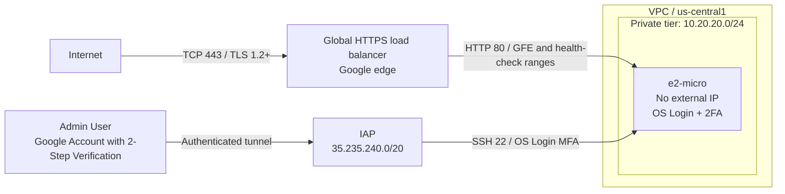

# Secure GCP infrastructure with Terraform

This module creates a custom VPC, one private regional subnet, one private
`e2-micro` VM, and a global external Application Load Balancer with an HTTPS-only
frontend. SSH uses IAP and OS Login with a second-factor challenge. No credentials,
SSH keys, TLS private keys, or workload secrets are stored in the configuration.

## Architecture



> [!NOTE]  
> This global external Application Load Balancer uses Google's edge infrastructure and does not require a public or proxy-only subnet. The module therefore creates only the private backend subnet, rather than the public and private subnets requested in the scenario. The public frontend uses a global IP address and a forwarding rule. Regional external Application Load Balancers have different subnet requirements; see [Google's architecture documentation](https://docs.cloud.google.com/load-balancing/docs/https).

> [!NOTE]
> The VPC firewall controls access to the backend VM. The frontend forwarding rule and HTTPS proxy enforce HTTPS for client connections; the proxy connects to the VM over HTTP on port 80. No port 80 listener is exposed to the internet. QUIC is disabled for simplicity.

## Network flows

| Path | Enforcement |
| --- | --- |
| Internet → load balancer | Only TCP 443; Google-managed certificate; MODERN TLS policy, minimum TLS 1.2 |
| Load balancer / health checks → VM | Only TCP 80 from `35.191.0.0/16` and `130.211.0.0/22` |
| IAP → VM | Only TCP 22 from trusted IAP range `35.235.240.0/20` |
| Other ingress → VM | Explicit deny, plus GCP's implicit deny |
| VM → other destinations | Initiated egress denied by VPC rules, except traffic exempt from filtering; stateful replies remain allowed |

Firewall rules target the dedicated VM service account. The VPC has no default
subnets or permissive internal/SSH rules, and no Cloud NAT. The only internet
gateway route is tagged for the backend's return traffic to GFE/IAP. A route
does not give a VM without an external IP or NAT unrestricted internet access.
Private Google Access is enabled, but the egress deny intentionally prevents
initiated API traffic. The Google metadata server remains available for OS Login,
DNS, DHCP and NTP; [GCP exempts it from VPC firewall
filtering](https://docs.cloud.google.com/firewall/docs/firewalls).

The trusted SSH source range is **IAP's proxy range**, not the user's public IP:
IAP replaces the client source address before the connection reaches the VM. See [IAP TCP
forwarding](https://docs.cloud.google.com/iap/docs/using-tcp-forwarding).

## Layout

```text
01-gcp-terraform/
  versions.tf, providers.tf       Terraform/provider configuration
  backend.tf, backend.hcl.example GCS backend with a dedicated state prefix
  services.tf                     Enable required APIs in an existing project
  main.tf                         Instantiate the reusable secure_web module
  variables.tf, outputs.tf        Deployment inputs and useful commands
  terraform.tfvars.example        Placeholder inputs only
  .terraform.lock.hcl             Local provider selections/checksums (gitignored)
  modules/secure_web/
    network.tf, firewall.tf       Private backend subnet and access boundaries
    compute.tf, iam.tf            Private VM, workload identity, human SSH access
    load_balancer.tf              Global HTTPS frontend and HTTP backend
    variables.tf, outputs.tf, versions.tf
    templates/                    Offline bootstrap and minimal HTTP application
  tests/                          Mocked Terraform security tests and backend tests
  budget-alerts/                  Budget and monthly trend alerts
  state-bootstrap/                Bucket bootstrap for Terraform states
```

## IAM and MFA

All grants use additive IAM member resources so existing policies are preserved.
No `roles/editor`, `roles/owner`, or default Compute Engine service account is used.

| Identity | Role / scope | Reason |
| --- | --- | --- |
| VM service account | No project roles; no OAuth scopes; no keys | Backend needs no Google API access |
| Each configured human | `roles/compute.osLogin` on this VM | SSH without sudo |
| Each configured human | `roles/iap.tunnelResourceAccessor` on this VM, conditioned on its IP and port 22 | SSH tunnel only |
| Each configured human | `roles/iam.serviceAccountUser` on this VM's service account | OS Login requirement for a VM with an attached identity |
| Each configured human | Custom project role with `compute.instances.get`, `compute.instances.list`, `compute.projects.get` | Minimum documented `gcloud compute ssh` discovery permissions |

`enable-oslogin=TRUE` and `enable-oslogin-2fa=TRUE` are set on the VM. Each user
must first [enable Google Account 2-Step Verification](https://myaccount.google.com/security).
Users without it cannot log in. IAP authenticates the tunnel; **OS Login enforces
the second factor during SSH authentication**, rather than relying only on MFA
at a previous browser login. The output SSH command disables connection sharing
so a new command authenticates a new SSH session. Google controls supported
challenge methods; see [OS Login 2FA](https://docs.cloud.google.com/compute/docs/oslogin/set-up-oslogin).

Google exempts service-account logins from OS Login 2FA. To avoid that bypass,
this module accepts only explicit human `user:` principals; service accounts and
groups are rejected. The module gives no principal service-account token-creation
rights or privileged OS Login rights. SSH hardening also disables local
`authorized_keys`, passwords, root login, agent forwarding, and TCP forwarding,
while preserving Google's OS Login PAM configuration.

The VM also enables Secure Boot, vTPM and integrity monitoring, disables serial
port access and legacy metadata endpoints, and blocks project metadata SSH keys.
The demo HTTP service runs under a dynamic unprivileged systemd user with limited
capabilities, a read-only filesystem, resource limits, and IP filtering that
prevents application access to the metadata server. The Python standard-library
backend serves only two fixed paths and needs no dependencies. 

CMK was not implemented for simplicity.

## Prerequisites and deployment

You need Terraform >= 1.7 and < 2.0, Google Cloud CLI, an existing project with billing,
and a DNS hostname you control. Your DNS provider is configured separately:
there is no paid Cloud DNS zone in this stack. The default image is Canonical's
Ubuntu 24.04 LTS GCP family, which includes Python 3 and the Google guest OS Login
components. `boot_image` can pin a compatible tested image.

The Terraform provisioning identity is separate from SSH users and the runtime
VM identity. It must be able to enable services and create/manage the resources
and IAM policies in this folder. A bootstrap administrator can assign the
following task-specific predefined roles instead of Editor or Owner:

| Provisioning role | Purpose |
| --- | --- |
| `roles/serviceusage.serviceUsageAdmin` | Enable required APIs |
| `roles/compute.networkAdmin` | VPC, subnet, route and instance group management |
| `roles/compute.securityAdmin` | Firewall and instance IAM policies |
| `roles/compute.instanceAdmin.v1` | VM and boot disk management |
| `roles/compute.loadBalancerAdmin` | HTTPS frontend, backend, health checks, certificates and TLS policy |
| `roles/iam.serviceAccountAdmin` | Create the dedicated account and manage its IAM policy |
| `roles/iam.roleAdmin` | Create the three-permission discovery role |
| `roles/resourcemanager.projectIamAdmin` | Bind the discovery role to SSH users |
| `roles/iap.policyAdmin` | Manage instance-scoped IAP tunnel policies |

It also needs `roles/iam.serviceAccountUser` on the VM service account to attach
that account to the VM. For initial creation, a bootstrap identity needs this
permission on the newly created account (an inherited project grant can be used
temporarily and reduced afterwards).


```bash
cd 01-gcp-terraform
gcloud auth login
gcloud auth application-default login
cp terraform.tfvars.example terraform.tfvars
# Edit project_id, domain_name and ssh_users in terraform.tfvars.
cp backend.hcl.example backend.hcl
# Set bucket to the bucket created by state-bootstrap.
# For existing local state, follow the migration instructions instead.
terraform init -backend-config=backend.hcl
terraform fmt -check -recursive
terraform validate
terraform test
python3 -m unittest discover -s tests -p 'test_*.py'
terraform plan -out=deployment.tfplan
terraform apply deployment.tfplan
```

After apply, obtain the frontend address:

```bash
terraform output -raw load_balancer_ip
```

Publish a DNS **A record** for `domain_name` pointing directly to that address.
Avoid a DNS-provider proxy during certificate validation, and remove stale AAAA
records (this stack exposes only IPv4). Ensure restrictive CAA records permit
Google's certificate issuers. A Google-managed certificate remains `PROVISIONING`
until DNS is correct and the certificate is attached to the serving proxy; apply
completion alone does not prove that HTTPS is ready. It can take around an hour
after DNS propagation. See [managed certificate provisioning and
troubleshooting](https://docs.cloud.google.com/load-balancing/docs/ssl-certificates/google-managed-certs).

Private `.tfvars`, saved plans,
and `.terraform/` are gitignored. Provider lockfiles are also currently ignored
and are not committed; a fresh initialization selects versions allowed by the
constraints in `versions.tf`.
The authoritative state uses a private GCS bucket with locking, versioning,
seven-day soft deletion and public access prevention. Infrastructure, budget
alerts and bucket configuration use distinct prefixes in that bucket.


## Verification after deployment

Set `PROJECT_ID` to your project in your shell; it is not a repository secret.

```bash
gcloud compute ssl-certificates describe "$(terraform output -raw certificate_name)" \
  --project="$PROJECT_ID" --global --format='yaml(managed)'
gcloud compute backend-services get-health "$(terraform output -raw backend_service_name)" \
  --project="$PROJECT_ID" --global
curl --fail --show-error "$(terraform output -raw https_url)/healthz"
# Print and run the generated command as one of the configured human users.
terraform output -raw ssh_command
```

Verify the certificate reports `ACTIVE`, backend health reports `HEALTHY`, and
HTTPS returns `ok`. Connect with the generated IAP SSH command and complete the
second-factor challenge. Repeat without approving the second factor: login must
fail. A separate human account with neither configured nor inherited access must
also be denied. Test permissions with a minimally privileged SSH user; a project
owner's inherited permissions cannot demonstrate least privilege.